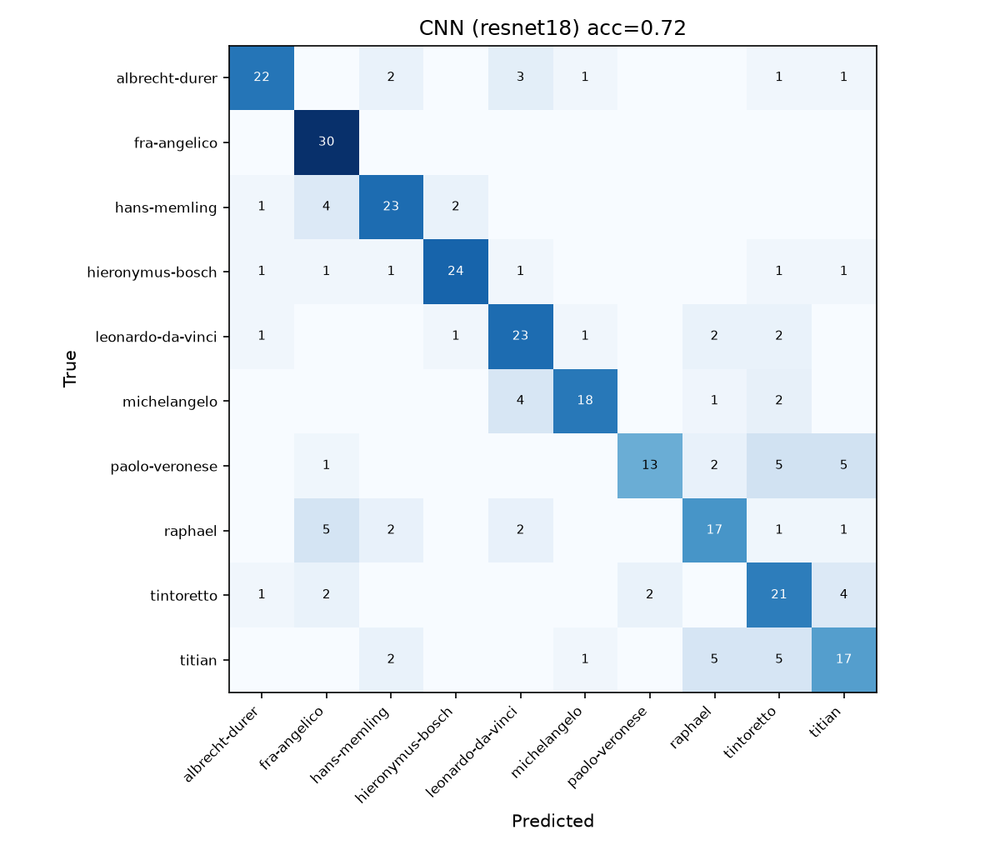
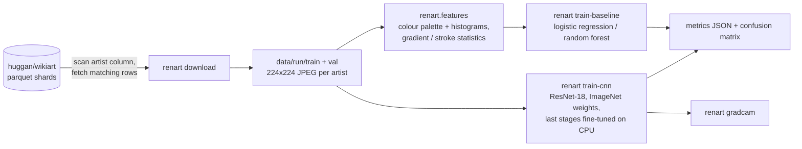

# Renart — style-based artist attribution for Renaissance paintings

Renart takes a photograph of a Renaissance painting and ranks which of ten
painters most likely made it, from the painting's style alone. It is a
reproducible pipeline, not a claim: every number below comes from a GitHub
Actions run whose metrics and confusion matrices are committed under
`results/`, with the command that produced them.

What it is **not**: an authentication or forgery-detection tool. A classifier
trained on style can tell a Titian from a Memling; it cannot tell a Titian
from a good copy of a Titian, and it says nothing about materials, age or
provenance. The earlier README described the project in those terms with
accuracy figures that no code in the repository produced. Those claims are
gone.

## Results

Run 3 of the training workflow, 2026-10-29
([metrics and plots](results/runs/run3-resnet18-10x150-8ep/)): ten painters, up to
150 WikiArt images each (1452 images, 1163 train / 289 validation),
224×224, ResNet-18 with the last stage fine-tuned for 8 epochs on a GitHub
Actions CPU runner (8 minutes of training).

| Model | Accuracy | Macro F1 | Top-3 accuracy |
|---|---|---|---|
| baseline-logreg | 0.509 | 0.506 | 0.813 |
| baseline-forest | 0.502 | 0.492 | 0.827 |
| cnn-resnet18 | 0.720 | 0.718 | 0.924 |
| chance | 0.100 | 0.100 | 0.300 |

The CNN gets about seven in ten validation paintings right and has the
painter in its top three 92% of the time. The classical
baseline, 102 colour and stroke features into a logistic regression, reaches
half; the gap between the two is the value of learned features over
hand-designed ones for this task.

Per painter (CNN, validation):

| Painter | Images | Accuracy |
|---|---|---|
| fra-angelico | 30 | 1.00 |
| hieronymus-bosch | 30 | 0.80 |
| hans-memling | 30 | 0.77 |
| leonardo-da-vinci | 30 | 0.77 |
| albrecht-durer | 30 | 0.73 |
| michelangelo | 25 | 0.72 |
| tintoretto | 30 | 0.70 |
| raphael | 28 | 0.61 |
| titian | 30 | 0.57 |
| paolo-veronese | 26 | 0.50 |



The confusions are the ones an art historian would predict: the three
Venetians (Titian, Tintoretto, Veronese) are confused with each other, and
Michelangelo's paintings are sometimes read as Leonardo's. Fra Angelico, with
his flat gold grounds, is never missed. Images per painter in the subset:
leonardo-da-vinci 150, raphael 143, titian 150, michelangelo 129, fra-angelico 150, tintoretto 150, paolo-veronese 130, albrecht-durer 150, hieronymus-bosch 150, hans-memling 150.

Reproduce: push a change to `.github/train-request.json` with
`{"smoke": false, "per_artist": 150, "max_artists": 10, "epochs": 8, "arch": "resnet18", "unfreeze": 1}`
or run the *Train* workflow by hand; the commands are listed below.

## Pipeline



**Data.** `renart download` builds a balanced subset of the
[`huggan/wikiart`](https://huggingface.co/datasets/huggan/wikiart) dataset.
Its `artist` column is an integer class label, so the script reads the label
names from the dataset metadata, maps the configured painter slugs to ids, and
scans the parquet shards reading only the `artist` column. Image bytes are
fetched just for the row groups that contain wanted painters, which keeps the
transfer far below the full dataset. Images are resized on the short side and
centre-cropped to 224×224 so paintings are not stretched. Every fifth image
per painter goes to validation.

**Classical baseline.** `renart.features` computes 102 hand-crafted features
per image: RGB and hue histograms, circular hue statistics, a 5-colour
k-means palette sorted by weight, and at two scales a Sobel-gradient
orientation histogram, anisotropy, orientation entropy, a curvature proxy
along strong edges, Laplacian sharpness and edge density. These port the
useful ideas from the project's first R scripts (`legacy/r/coloranalysis.r`,
`legacy/r/paintstroke.r`) into something that runs on a photograph. A
standardised logistic regression (or random forest) is trained on them.

**CNN.** `renart.cnn` fine-tunes an ImageNet-pretrained ResNet-18 with the
last residual stage(s) and the classifier unfrozen, AdamW, cosine schedule,
label smoothing, and light augmentation (random resized crop, flip, colour
jitter). It keeps the epoch with the best validation accuracy. Training runs
on the CPU of a GitHub Actions runner.

**Evaluation.** `renart.metrics` reports accuracy, macro-F1, top-3 accuracy,
per-class accuracy and a confusion matrix for both models on the same
validation split, against a chance rate of 1/10.

## Reproduce it

Everything runs from one workflow, `.github/workflows/train.yml`:

- from the Actions tab, *Train → Run workflow* (once this branch is merged);
- or on any branch, change `.github/train-request.json` and push. The commit
  starts the run; results land in `results/latest/` as a commit on the same
  branch.

Locally, with a folder of images laid out as `data/<split>/<artist>/*.jpg`:

```sh
pip install -e ".[data,train,dev]"           # torch CPU wheels: see the workflow
python -m renart download --data data/run    # needs network; --smoke for a 2-artist test
python -m renart train-baseline --data data/run --out results
python -m renart train-cnn --data data/run --out results --epochs 8
python -m renart gradcam --model results/cnn.pt --data data/run
python -m renart predict --model results/cnn.pt some-painting.jpg
python -m renart report results/metrics_*.json
```

`pytest` runs in seconds with no network and no torch: the feature extractor,
baseline, metrics and CLI are tested on synthetic "paintings".

## Limitations

- **Ten painters, WikiArt images.** The model only chooses among the ten
  classes it saw; anything else is forced into one of them. WikiArt images
  vary in resolution, colour balance and framing, and some are details or
  studies rather than finished paintings.
- **Style ≠ authorship.** Workshop pieces, pupils and later copies share a
  master's style by design. The Venetian confusions in the matrix (Titian,
  Tintoretto, Veronese) are exactly what a style model should get wrong.
- **Small validation set.** With about 30 images per painter, a single
  image moves per-class accuracy by over three points. Treat the figures as
  indicative, not final.
- **No test set.** The best epoch is chosen on the same split that is
  reported, which biases the CNN's figure slightly upward. A held-out test
  split is the obvious next step.
- **CPU budget.** ResNet-18 at 224 px for a handful of epochs. A larger
  backbone, higher resolution and more images per painter would all help.

## Layout

```
renart/        the package: config, data, download, features, baseline, cnn, gradcam, metrics, cli
tests/         pytest suite on synthetic images (no network, no torch)
results/       latest/ = most recent Actions run; runs/ = kept runs referenced above
legacy/        the earlier R and TensorFlow.js attempts and the first dataset script
.github/       ci.yml (ruff + pytest) and train.yml (the training run)
```

## License

MIT
