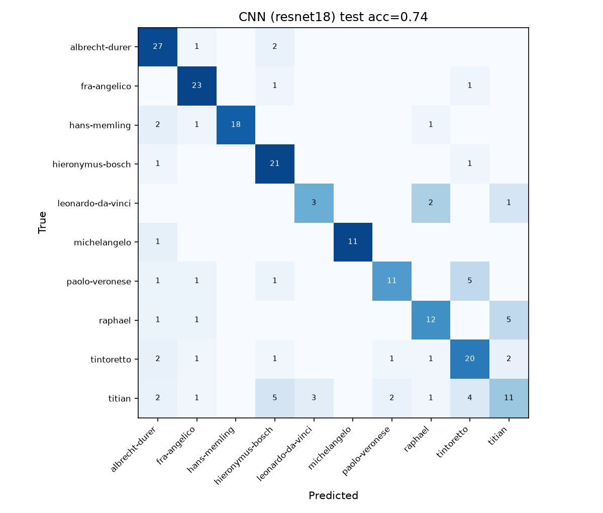
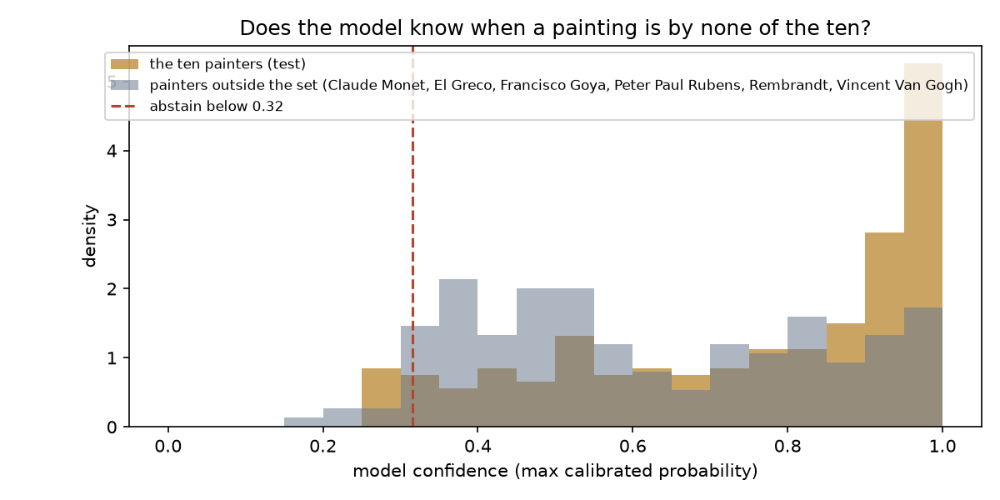
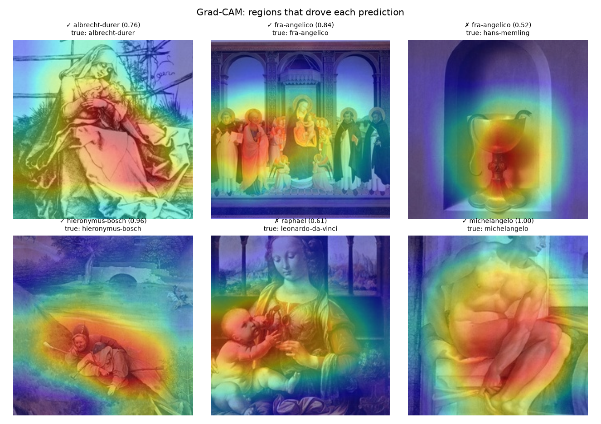
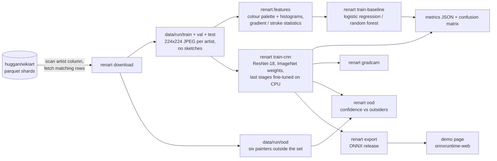

# Renart: style-based artist attribution for Renaissance paintings

Renart takes a photograph of a Renaissance painting and ranks which of ten
painters most likely made it, from the painting's style alone. It is a
reproducible pipeline, not a claim: every number below comes from a GitHub
Actions run whose metrics and confusion matrices are committed under
`results/`, with the command that produced them.

What it is **not**: an authentication or forgery-detection tool. A classifier
trained on style can tell a Titian from a Memling; it cannot tell a Titian
from a good copy of a Titian, and it says nothing about materials, age or
provenance. The earlier README described the project in those terms with
accuracy figures that no code in the repository produced. Those claims are
gone.

**Results site: [kennethkimbrough.github.io/Renart](https://kennethkimbrough.github.io/Renart/)**,
with every model's accuracy and its 95% interval, an interactive confusion
matrix grouped by school, painter-by-painter results and the out-of-set
check. **Try it: [the demo page](https://kennethkimbrough.github.io/Renart/demo.html)**
runs the trained network in your browser (ONNX + onnxruntime-web): drop in a
painting, or pick one of the test paintings, and it ranks the ten painters.
Nothing is uploaded.

## Results

Run 8 of the training workflow, 2026-10-30
([metrics and plots](results/runs/run8-test-split-no-sketches/)): ten
painters, up to 200 WikiArt paintings each with drawings and studies removed
(1429 images), split per painter into 70% train, 15% validation and 15% test.
ResNet-18 with the last two residual stages fine-tuned for 12 epochs on a
GitHub Actions CPU runner (13 minutes of training). Validation picks the
epoch and fits the calibration temperature; **every number below is from the
test split, which no training or selection step saw.**

| Model | Test accuracy (95% interval) | Macro F1 | Top-3 accuracy |
|---|---|---|---|
| cnn-resnet18 | **0.737** (0.674–0.792) | 0.726 | 0.892 |
| baseline-forest | 0.582 (0.515–0.646) | 0.512 | 0.817 |
| baseline-logreg | 0.559 (0.492–0.624) | 0.511 | 0.775 |
| chance | 0.100 | 0.100 | 0.300 |

The CNN names the right painter for 157 of 213 test paintings and has
the right one in its top three 89% of the time. The classical baseline (102
colour and stroke features) reaches 56–58%; the gap is the value of learned
features over hand-designed ones here.

**Why this is lower than the earlier 77.7%.** Run 5 made the same request
but picked its best epoch on the same validation images it reported, and kept
WikiArt's drawings and studies. Removing those took 122 images from
Leonardo and 50 from Michelangelo, which had partly taught the model "pen on
paper" rather than brushwork. 73.7% on an untouched test split is the
figure to quote; run 5's
([results](results/runs/run5-resnet18-10x200-12ep-unfreeze2/)) was
optimistic. Run 6 had repeated run 5 on another runner and matched it at
every epoch, so the pipeline is deterministic from its seeds.

Per painter (CNN, test):

| Painter | Test images | Accuracy |
|---|---|---|
| fra-angelico | 25 | 0.92 |
| michelangelo | 12 | 0.92 |
| hieronymus-bosch | 23 | 0.91 |
| albrecht-durer | 30 | 0.90 |
| hans-memling | 22 | 0.82 |
| tintoretto | 28 | 0.71 |
| raphael | 19 | 0.63 |
| paolo-veronese | 19 | 0.58 |
| leonardo-da-vinci | 6 | 0.50 |
| titian | 29 | 0.38 |



Titian is the weak spot: 11 of 29 right, with his paintings spread over
Bosch, Tintoretto and Leonardo, and Raphael is read as Titian five times
out of 19. Veronese goes to Tintoretto five times. Across all ten painters,
22 of the CNN's 56 mistakes (39%) name a painter from the same school
(north of the Alps, Florence and Rome, or Venice), against 25% if mistakes
were spread at random. Leonardo's figure rests on six test paintings and
means little.

**Calibration.** Temperature scaling on validation (T = 1.01) left the
network almost unchanged: its confidence was already close to its accuracy
(expected calibration error 0.061 on test). A shown confidence of 70% means
roughly seven right answers in ten.

**Does it know when a painting is by none of the ten?** Not well, and the
demo says so. 150 paintings by six painters outside the set (El Greco,
Rubens, Rembrandt, Goya, Monet, Van Gogh) were scored alongside the test
split. Confidence separates them from the ten with an AUROC of only 0.67;
at a threshold that keeps 95% of the ten painters' paintings, just 7% of the
outsiders are turned away, and Rembrandt (AUROC 0.52) not at all. A
ten-way softmax classifier is a poor judge of "none of these"; a dedicated
open-set method is the next step.





Grad-CAM shows where the network looked for six test paintings, one per
painter, each titled with its answer, confidence and the true painter.

Reproduce: push a change to `.github/train-request.json` with
`{"smoke": false, "per_artist": 200, "max_artists": 10, "epochs": 12, "arch": "resnet18", "unfreeze": 2, "ood_per_artist": 25}`
or run the *Train* workflow by hand. The run commits its metrics, exports the
network to ONNX (checked against PyTorch with onnxruntime), and publishes it
as a release such as
[`model-run8`](https://github.com/kennethkimbrough/Renart/releases/tag/model-run8)
that the demo page serves.

## Pipeline



**Data.** `renart download` builds a balanced subset of the
[`huggan/wikiart`](https://huggingface.co/datasets/huggan/wikiart) dataset.
Its `artist` column is an integer class label, so the script reads the label
names from the dataset metadata, maps the configured painter slugs to ids, and
scans the parquet shards reading only the `artist` column. Image bytes are
fetched just for the row groups that contain wanted painters, which keeps the
transfer far below the full dataset. Images are resized on the short side and
centre-cropped to 224×224 so paintings are not stretched. Rows in WikiArt's
`sketch_and_study` genre are skipped. Each painter's images are split 70/15/15
into train, validation and test by position in the sequence
(`renart.config.split_for`), so the three splits are alike.

**Classical baseline.** `renart.features` computes 102 hand-crafted features
per image: RGB and hue histograms, circular hue statistics, a 5-colour
k-means palette sorted by weight, and at two scales a Sobel-gradient
orientation histogram, anisotropy, orientation entropy, a curvature proxy
along strong edges, Laplacian sharpness and edge density. These port the
useful ideas from the project's first R scripts (`legacy/r/coloranalysis.r`,
`legacy/r/paintstroke.r`) into something that runs on a photograph. A
standardised logistic regression (or random forest) is trained on them.

**CNN.** `renart.cnn` fine-tunes an ImageNet-pretrained ResNet-18 with the
last residual stage(s) and the classifier unfrozen, AdamW, cosine schedule,
label smoothing, and light augmentation (random resized crop, flip, colour
jitter). It keeps the epoch with the best validation accuracy and fits a
calibration temperature on validation. Training runs on the CPU of a GitHub
Actions runner.

**Evaluation.** `renart.metrics` reports accuracy, macro-F1, top-3 accuracy,
per-class accuracy, a confusion matrix and expected calibration error for
every model on the same test split, against a chance rate of 1/10.
`renart ood` scores paintings by six painters outside the set and reports
AUROC and an abstention threshold.

## Reproduce it

Everything runs from one workflow, `.github/workflows/train.yml`:

- from the Actions tab, *Train → Run workflow* (once this branch is merged);
- or on any branch, change `.github/train-request.json` and push. The commit
  starts the run; results land in `results/latest/` as a commit on the same
  branch.

Locally, with a folder of images laid out as `data/<split>/<artist>/*.jpg`:

```sh
pip install -e ".[data,train,dev]"           # torch CPU wheels: see the workflow
python -m renart download --data data/run    # needs network; --smoke for a 2-artist test
python -m renart download-ood --data data/run
python -m renart train-baseline --data data/run --out results
python -m renart train-cnn --data data/run --out results --epochs 8
python -m renart ood --model results/cnn.pt --data data/run
python -m renart export --model results/cnn.pt --out results/renart.onnx
python -m renart gradcam --model results/cnn.pt --data data/run
python -m renart predict --model results/cnn.pt some-painting.jpg
python -m renart report results/metrics_*.json
python -m renart site --out site             # results site + demo page, from the run in site.toml
```

`pytest` runs in seconds with no network and no torch: the feature extractor,
baseline, metrics, results site and CLI are tested on synthetic "paintings"
and synthetic results.

## Limitations

- **Ten painters, WikiArt images.** The model only chooses among the ten
  painters it saw, and it is poor at noticing when a painting is by none of
  them (AUROC 0.67 above).
- **Style ≠ authorship.** Workshop pieces, pupils and later copies share a
  master's style by design; Renart says nothing about materials, age or
  provenance.
- **Small test set.** 213 paintings, as few as six for Leonardo. Treat
  per-painter figures as indicative.
- **CPU budget.** ResNet-18 at 224 px for 12 epochs. A larger backbone,
  higher resolution and more images per painter would all help.

## Layout

```
renart/        the package: config, data, download, features, baseline, cnn, gradcam, metrics, cli
renart/site.py the results site: committed metrics -> one self-contained index.html (site_template.html)
site.toml      which run the site shows, its repeat and earlier run, and the painters' schools
tests/         pytest suite on synthetic images and results (no network, no torch)
results/       latest/ = most recent Actions run; runs/ = kept runs referenced above
renart/demo_template.html  the in-browser demo (onnxruntime-web), built next to the results page
legacy/        the earlier R and TensorFlow.js attempts and the first dataset script
.github/       ci.yml (ruff + pytest), train.yml (the training run), pages.yml (the results site)
```

## License

MIT
