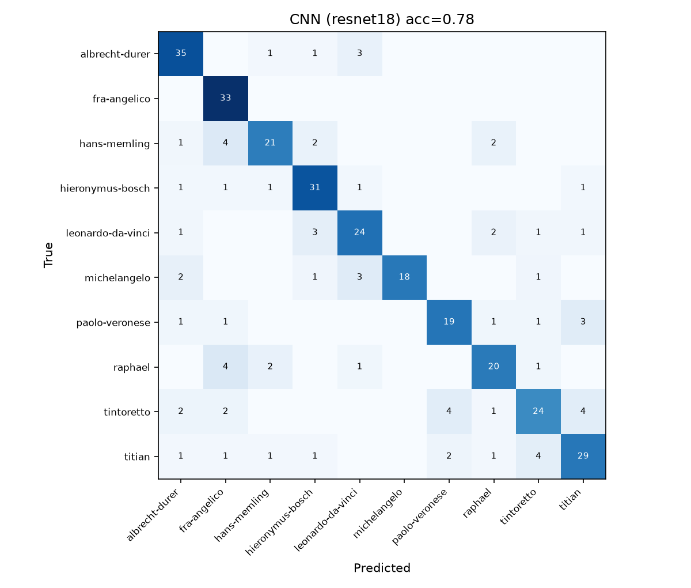
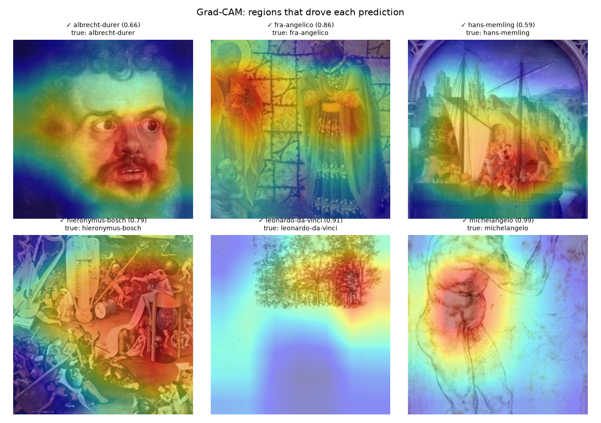
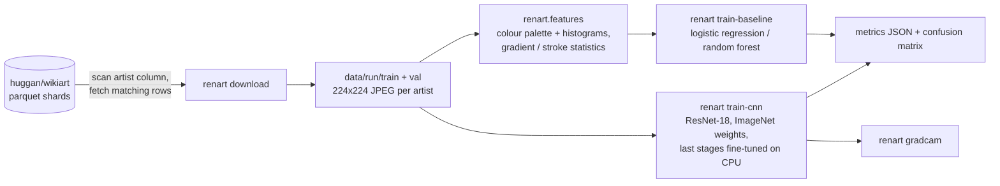

# Renart: style-based artist attribution for Renaissance paintings

Renart takes a photograph of a Renaissance painting and ranks which of ten
painters most likely made it, from the painting's style alone. It is a
reproducible pipeline, not a claim: every number below comes from a GitHub
Actions run whose metrics and confusion matrices are committed under
`results/`, with the command that produced them.

What it is **not**: an authentication or forgery-detection tool. A classifier
trained on style can tell a Titian from a Memling; it cannot tell a Titian
from a good copy of a Titian, and it says nothing about materials, age or
provenance. The earlier README described the project in those terms with
accuracy figures that no code in the repository produced. Those claims are
gone.

**Results site: [kennethkimbrough.github.io/Renart](https://kennethkimbrough.github.io/Renart/)**,
with every model's accuracy and its 95% interval, an interactive confusion
matrix grouped by school, painter-by-painter results against the baseline, and
the training curve. It is built from the committed run on every push.

## Results

Run 5 of the training workflow, 2026-10-30
([metrics and plots](results/runs/run5-resnet18-10x200-12ep-unfreeze2/)): ten painters, every WikiArt image available up to
200 each (1653 images, 1326 train / 327 validation), 224×224,
ResNet-18 with the last two residual stages fine-tuned for 12 epochs on a
GitHub Actions CPU runner (13 minutes of training; the download
took another 13).

| Model | Accuracy | Macro F1 | Top-3 accuracy |
|---|---|---|---|
| baseline-logreg | 0.526 | 0.517 | 0.813 |
| baseline-forest | 0.523 | 0.499 | 0.823 |
| cnn-resnet18 | 0.777 | 0.774 | 0.960 |
| chance | 0.100 | 0.100 | 0.300 |

The CNN gets 77.7% of validation paintings right and has the painter
in its top three 96.0% of the time. The classical baseline, 102
colour and stroke features into a logistic regression, reaches 52.6%; the
gap between the two is the value of learned features over hand-designed ones
for this task. An earlier run with fewer images, fewer epochs and only the
last stage unfrozen ([run 3](results/runs/run3-resnet18-10x150-8ep/)) scored 72.0% / top-3 92.4%,
so the extra data and capacity were worth about five points (the two runs
were scored on different validation sets, 289 and 327 images, so that is a
direction rather than a like-for-like measurement).

The 95% interval on the CNN's 77.7% is 73–82% (Wilson, over 327 images);
the baseline's is 47–58%. **Run 6 repeated run 5's request as a separate job
on another runner and reproduced it exactly**: the same loss and accuracy at
every epoch, the same confusion matrices for all three models and a
byte-identical Grad-CAM image ([run 6](results/runs/run6-repeat-of-run5/)).

Per painter (CNN, validation):

| Painter | Images | Accuracy |
|---|---|---|
| fra-angelico | 33 | 1.00 |
| albrecht-durer | 40 | 0.88 |
| hieronymus-bosch | 36 | 0.86 |
| leonardo-da-vinci | 32 | 0.75 |
| paolo-veronese | 26 | 0.73 |
| titian | 40 | 0.72 |
| michelangelo | 25 | 0.72 |
| raphael | 28 | 0.71 |
| hans-memling | 30 | 0.70 |
| tintoretto | 37 | 0.65 |



The confusions are the ones an art historian would predict: the Venetians
(Titian, Tintoretto, Veronese) are confused with each other: 18 of the 103
Venetian validation images land on another Venetian. Raphael is read as
Fra Angelico four times out of 28, and Fra Angelico himself, with his flat
gold grounds, is never missed. Across all ten painters, 35 of the CNN's 73
mistakes (48%) name a painter from the same school (north of the Alps,
Florence and Rome, or Venice); mistakes spread at random would do that about
26% of the time, and the logistic-regression baseline's figure is 35%. Images per painter in the subset:
leonardo-da-vinci 164, raphael 143, titian 200, michelangelo 129, fra-angelico 167, tintoretto 187, paolo-veronese 130, albrecht-durer 200, hieronymus-bosch 182, hans-memling 151.



Grad-CAM shows where the network looked for six validation images: faces and
flesh for Dürer and Michelangelo, the crowded figure groups for Bosch and
Memling. It also shows a weakness of the data: WikiArt mixes drawings and
studies in with finished paintings, so part of what the model learns for
Leonardo and Michelangelo is "pen on paper", not brushwork.

Reproduce: push a change to `.github/train-request.json` with
`{"smoke": false, "per_artist": 200, "max_artists": 10, "epochs": 12, "arch": "resnet18", "unfreeze": 2}`
or run the *Train* workflow by hand; the commands are listed below.

## Pipeline



**Data.** `renart download` builds a balanced subset of the
[`huggan/wikiart`](https://huggingface.co/datasets/huggan/wikiart) dataset.
Its `artist` column is an integer class label, so the script reads the label
names from the dataset metadata, maps the configured painter slugs to ids, and
scans the parquet shards reading only the `artist` column. Image bytes are
fetched just for the row groups that contain wanted painters, which keeps the
transfer far below the full dataset. Images are resized on the short side and
centre-cropped to 224×224 so paintings are not stretched. Every fifth image
per painter goes to validation.

**Classical baseline.** `renart.features` computes 102 hand-crafted features
per image: RGB and hue histograms, circular hue statistics, a 5-colour
k-means palette sorted by weight, and at two scales a Sobel-gradient
orientation histogram, anisotropy, orientation entropy, a curvature proxy
along strong edges, Laplacian sharpness and edge density. These port the
useful ideas from the project's first R scripts (`legacy/r/coloranalysis.r`,
`legacy/r/paintstroke.r`) into something that runs on a photograph. A
standardised logistic regression (or random forest) is trained on them.

**CNN.** `renart.cnn` fine-tunes an ImageNet-pretrained ResNet-18 with the
last residual stage(s) and the classifier unfrozen, AdamW, cosine schedule,
label smoothing, and light augmentation (random resized crop, flip, colour
jitter). It keeps the epoch with the best validation accuracy. Training runs
on the CPU of a GitHub Actions runner.

**Evaluation.** `renart.metrics` reports accuracy, macro-F1, top-3 accuracy,
per-class accuracy and a confusion matrix for both models on the same
validation split, against a chance rate of 1/10.

## Reproduce it

Everything runs from one workflow, `.github/workflows/train.yml`:

- from the Actions tab, *Train → Run workflow* (once this branch is merged);
- or on any branch, change `.github/train-request.json` and push. The commit
  starts the run; results land in `results/latest/` as a commit on the same
  branch.

Locally, with a folder of images laid out as `data/<split>/<artist>/*.jpg`:

```sh
pip install -e ".[data,train,dev]"           # torch CPU wheels: see the workflow
python -m renart download --data data/run    # needs network; --smoke for a 2-artist test
python -m renart train-baseline --data data/run --out results
python -m renart train-cnn --data data/run --out results --epochs 8
python -m renart gradcam --model results/cnn.pt --data data/run
python -m renart predict --model results/cnn.pt some-painting.jpg
python -m renart report results/metrics_*.json
python -m renart site --out site             # the results site, from the run named in site.toml
```

`pytest` runs in seconds with no network and no torch: the feature extractor,
baseline, metrics, results site and CLI are tested on synthetic "paintings"
and synthetic results.

## Limitations

- **Ten painters, WikiArt images.** The model only chooses among the ten
  classes it saw; anything else is forced into one of them. WikiArt images
  vary in resolution, colour balance and framing, and some are details or
  studies rather than finished paintings.
- **Style ≠ authorship.** Workshop pieces, pupils and later copies share a
  master's style by design. The Venetian confusions in the matrix (Titian,
  Tintoretto, Veronese) are exactly what a style model should get wrong.
- **Small validation set.** With 25–40 images per painter, a single image
  moves per-class accuracy by three or four points. Treat the figures as
  indicative, not final.
- **No test set.** The best epoch is chosen on the same split that is
  reported, which biases the CNN's figure slightly upward. A held-out test
  split is the obvious next step.
- **CPU budget.** ResNet-18 at 224 px for a handful of epochs. A larger
  backbone, higher resolution and more images per painter would all help.

## Layout

```
renart/        the package: config, data, download, features, baseline, cnn, gradcam, metrics, cli
renart/site.py the results site: committed metrics -> one self-contained index.html (site_template.html)
site.toml      which run the site shows, its repeat and earlier run, and the painters' schools
tests/         pytest suite on synthetic images and results (no network, no torch)
results/       latest/ = most recent Actions run; runs/ = kept runs referenced above
legacy/        the earlier R and TensorFlow.js attempts and the first dataset script
.github/       ci.yml (ruff + pytest), train.yml (the training run), pages.yml (the results site)
```

## License

MIT
